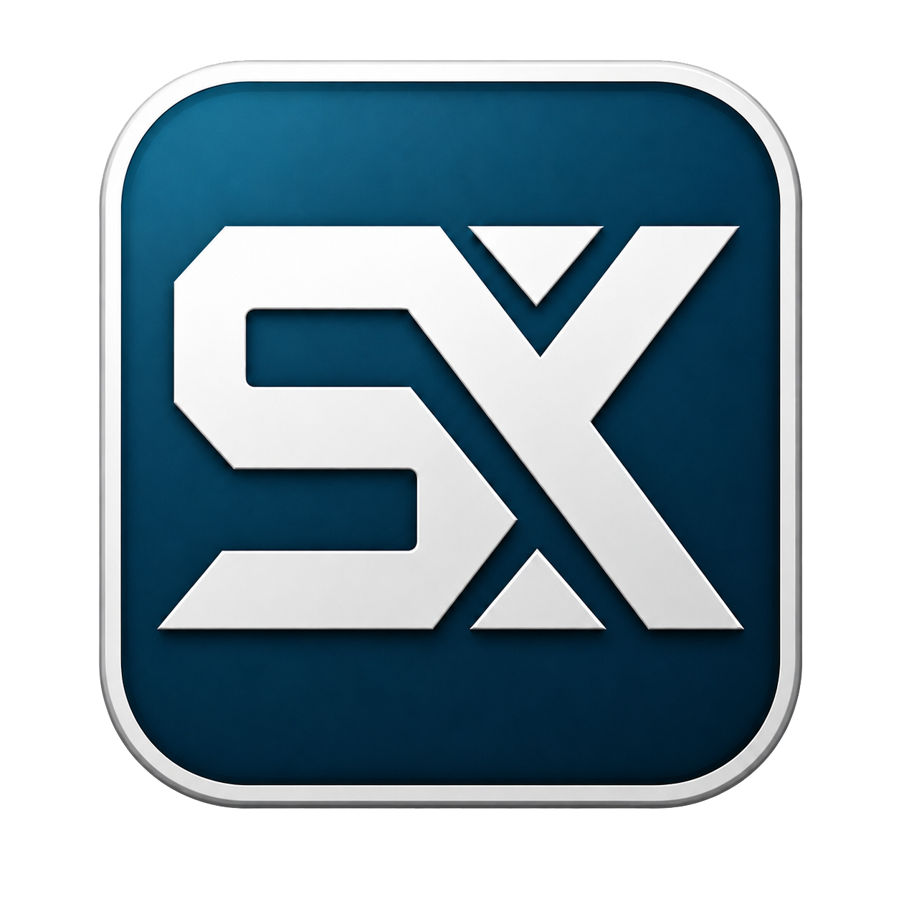

<p align="center">
  
</p>

# SavanXP Legacy Edition

This branch progressively ports SavanXP to **i386 (32-bit x86), legacy BIOS and
GRUB2/Multiboot2**. All normal build and run commands target i386. The original
x86_64 system is maintained on [`master`](https://github.com/SavanDev/SavanXP/tree/master).

Current version: `v0.4.0` · [Changelog](CHANGELOG.md) · [MIT license](LICENSE)

## Quick start

On Linux, install Clang/LLVM, CMake, Ninja, Python 3 with Pillow, Git,
`qemu-system-i386`, `xorriso`, and `grub-mkrescue` with the `i386-pc` platform files.
OVMF and Limine are not required. See [host setup](docs/BUILD_LINUX.md).

```bash
./build.sh build       # build ELF32 kernel/userland and sync the persistent disk
./build.sh run         # build the GRUB ISO and boot it with the disk in QEMU
./build.sh smoke       # boot, keyboard, preemption/lifecycle and desktop checks
./build.sh test        # host regressions
```

`run` uses SeaBIOS/i440FX, a `qemu32` CPU, VGA, PS/2 and an IDE disk. TCG is the
default; `--accel kvm` selects KVM. `debug` starts paused with a GDB server on
port 1234. `--headless` disables the QEMU window. SMP and virtio are not ported.

## What works today

- Multiboot2 boot, COM1 logging, EGA fallback and a framebuffer text console.
- PIC/PIT interrupts, PS/2 keyboard and mouse.
- ATA PIO, partition discovery and persistent SxFS mounted at `/disk`.
- Static ELF32 programs in ring 3, private memory and kernel stacks.
- PIT preemption with x87/SSE state, `spawn`, `waitpid`, `exit`, sleep and yield.
- `init32`, the interactive `sh32` shell, `sysinfo`, and a minimal `desktop32`.
- External static SDK applications built with `tools/build-user.sh`.

At boot, `init32` runs `sysinfo` and starts `sh32`; it restarts the shell when it
exits. Try:

```text
help
sysinfo
uptime
multitest
desktop
run /disk/bin/hello
start /disk/bin/hello
wait 5
```

`wait` takes the PID printed by `start`. `desktop` opens the minimal graphical
desktop as a child of the shell. This branch has not yet ported the full window
manager, shared libraries, BusyBox, networking or audio. Retained source and old
design documents are porting material, not claims of working i386 features.
See the [ordered porting roadmap](docs/I386_PORT.md) and
[process implementation and limits](docs/I386_PROCESSES.md).

## Build products and persistence

The default CMake directory is `build/linux-i386/`, separate from old x86_64
caches. Products use the normal paths:

- `build/kernel.elf`: ELF32 kernel.
- `build/disk.img`: persistent SxFS disk, updated additively.
- `build/SavanXP.iso`: BIOS boot ISO, generated by `./build.sh iso` or `run`.
- `build/diskfs/`: the currently staged internal userland.

An existing valid `build/disk.img` is preserved, including external binaries and
`/disk/games` data. Old ELF64 files remain on disk but cannot execute on i386.
Rebuild individual applications as they are ported. The earlier experimental
`build/i386/disk-i386.img` is left untouched; it is not migrated automatically.
The ISO needs the separate disk for userland; it is not a standalone LiveCD.

`./build.sh clean` preserves the disk and external artifacts.
`--no-test-apps` omits `keyecho` and `multitest32` from staging; additive sync
keeps previously installed copies. Smoke runs include diagnostics and use disk
snapshots. Tool locations come from `PATH` or documented overrides; see
[the build graph](docs/BUILD_CMAKE.md).

## External applications

```bash
./build.sh build
./tools/build-user.sh --source sdk/hello/main.c --name hello
./build.sh run
```

The builder emits static ELF32 at the i386 user address and installs it under
`/disk/bin/NAME`. Execute it with `run /disk/bin/hello` in `sh32`. Source code
that uses unported syscalls still needs work. Third-party port runtime support
is tracked separately; successful installation or preservation does not prove
that an application can run yet.
