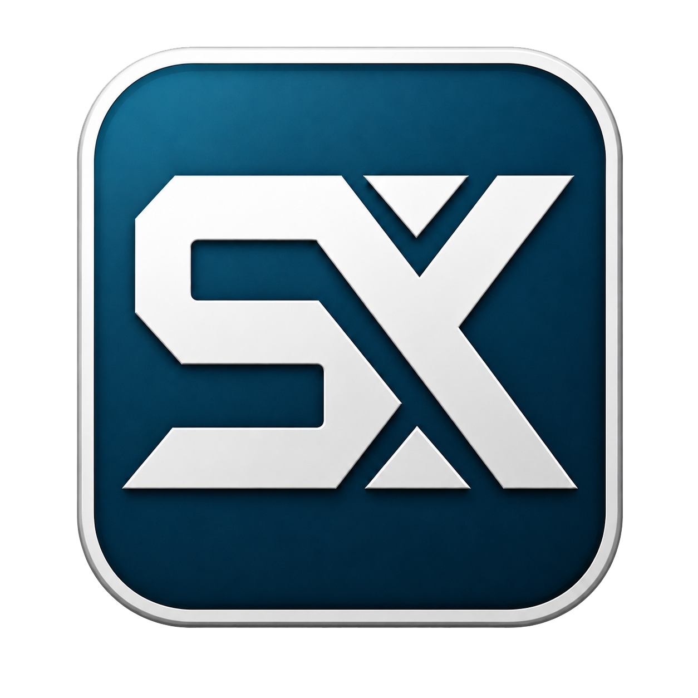
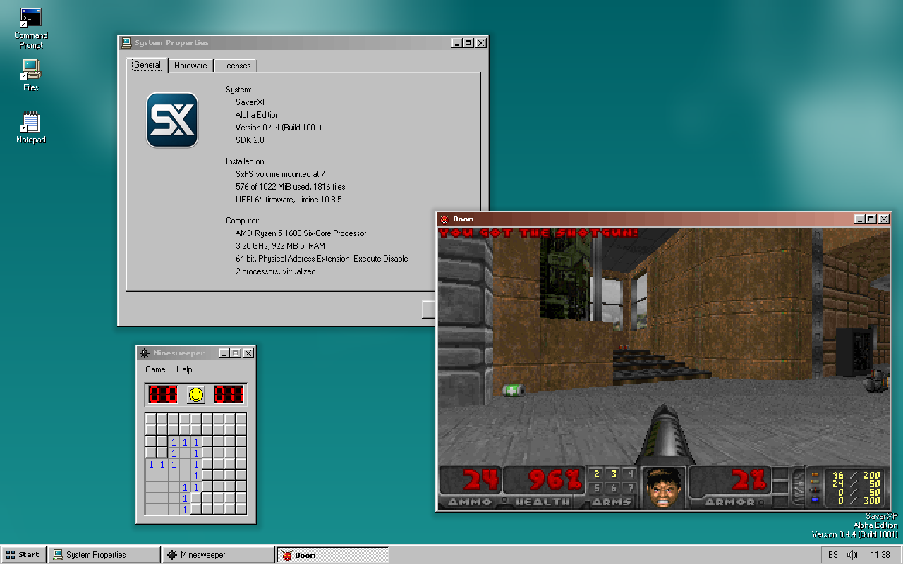
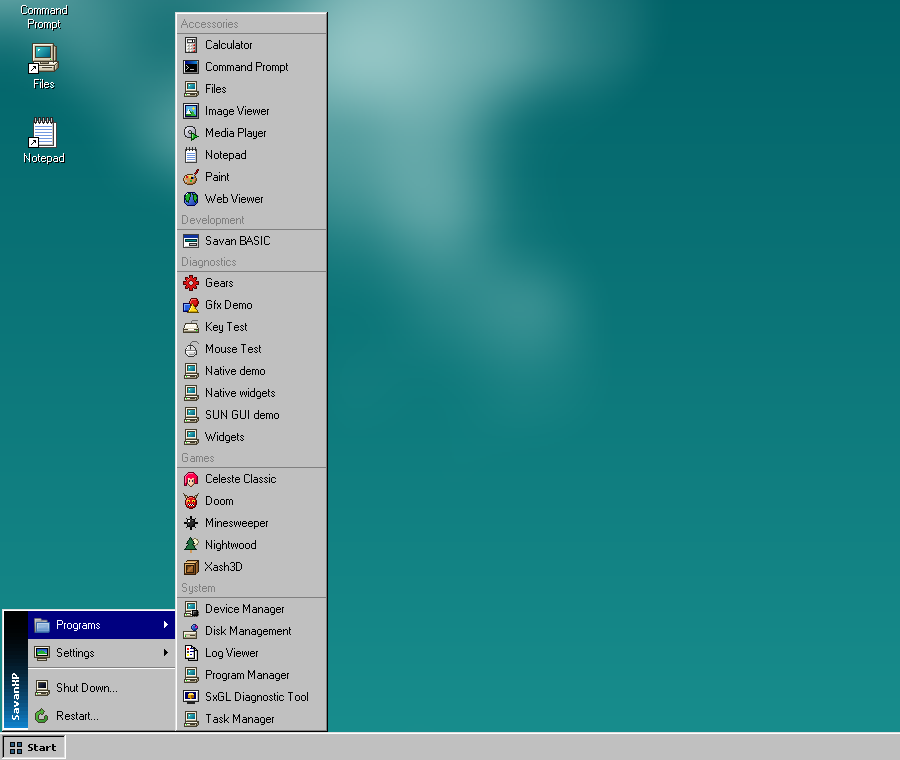
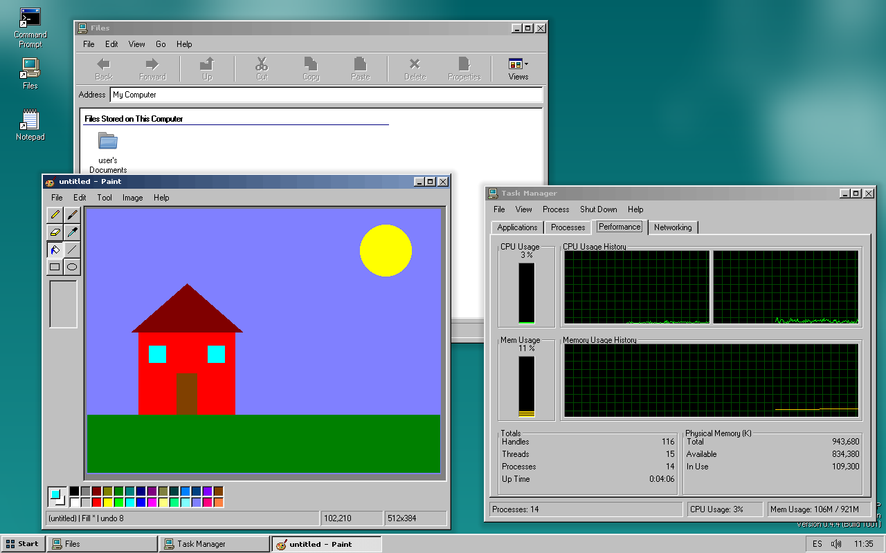
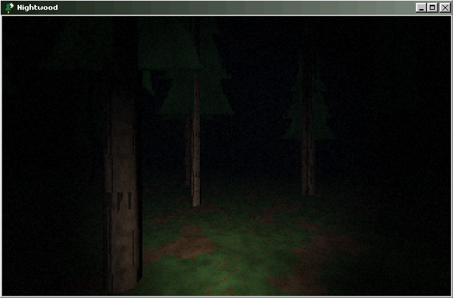
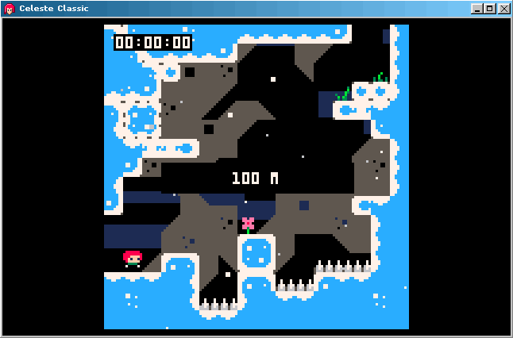
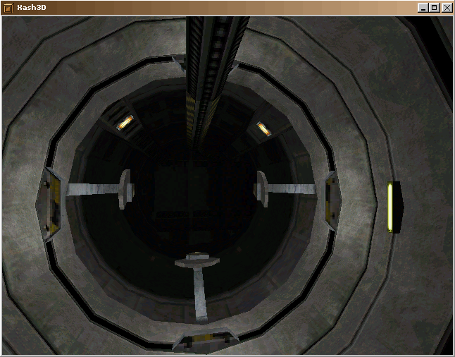
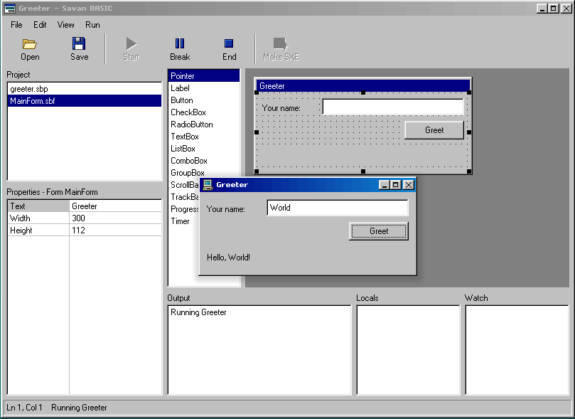

<p align="center">
  
</p>

<h1 align="center">SavanXP</h1>

<p align="center">
  <b>A hobby operating system with the soul of a late-90s desktop.</b><br>
  Its own kernel, its own windows, its own apps — and Doom, of course.
</p>

<p align="center">
  <a href="https://github.com/SavanDev/SavanXP/releases/latest"></a>
  <a href="LICENSE"></a>
  
  
  
  <a href="https://github.com/SavanDev/SavanXP/commits/master"></a>
</p>

<p align="center">
  <br>
  <sub>System Properties, Minesweeper and Doom (with Freedoom) on the SavanXP desktop.</sub>
</p>

## What is this?

SavanXP is an operating system written from scratch for 64-bit PCs. It is not
Linux and not Windows underneath: the kernel, the window manager, the file
system and the apps are all built here. It boots into a desktop that looks
like the computers of around the year 2000 — grey 3D buttons, a Start menu,
a taskbar with a clock — and it runs in a virtual machine or on a real PC
from a USB stick.

It is an experiment and a labour of love, built in the open with AI
assistance. It is not meant to replace your OS; it is meant to be fun to
boot, poke at and build on.

## What you can do in it

- 🪟 **Use a real desktop.** Windows that move and overlap, a Start menu,
  Alt+Tab, a taskbar, right-click menus, a Task Manager with live graphs.
- 🗂️ **Work with files.** A file manager, Notepad, Paint, a calculator, a
  Command Prompt and a small web browser of its own.
- 🎮 **Play.** Minesweeper, *Nightwood* (a 3D night walk through a forest),
  and ports of Doom, Celeste Classic and the Half-Life engine.
- 💾 **Keep your stuff.** Files saved inside SavanXP survive a reboot.
- 🔌 **Run it on metal.** Boots on real PCs, with USB keyboards, mice and
  sticks, SATA and NVMe disks, and sound.
- 🛠️ **Write programs for it.** Savan BASIC, a Visual Basic-style
  environment, runs inside the system; an SDK compiles your own C apps on
  Linux and installs them straight into it.

## Screenshots

<table>
  <tr>
    <td width="50%"><br><sub><b>The Start menu</b> and the programs it opens.</sub></td>
    <td width="50%"><br><sub><b>Built-in apps:</b> Files, Paint, Task Manager and more.</sub></td>
  </tr>
  <tr>
    <td><br><sub><b>Nightwood</b>, a 3D game drawn by SavanXP's own OpenGL-style renderer.</sub></td>
    <td><br><sub><b>Celeste Classic</b>, the PICO-8 original, through the ccleste port.</sub></td>
  </tr>
  <tr>
    <td><br><sub><b>Half-Life</b> on the Xash3D engine (game data not included).</sub></td>
    <td><br><sub><b>Savan BASIC</b>: design a window, write the code, press Start.</sub></td>
  </tr>
</table>

## Try it

**The quick way:** download the ISO from the
[latest release](https://github.com/SavanDev/SavanXP/releases/latest) and
boot it in a virtual machine such as QEMU or VirtualBox, with 1 GB of RAM or
more. It works with either UEFI or classic BIOS.

**On a real PC:** write the ISO to a USB stick with
[Rufus](https://rufus.ie) (DD mode) or `dd`, turn Secure Boot off and boot
from the stick. It runs from memory and does not touch your disks unless you
ask it to. The details, and what hardware is known to work, are in
[Running on real hardware](docs/build/DEVELOPING.md#running-on-real-hardware).

**From source** (Linux):

```bash
git clone https://github.com/SavanDev/SavanXP.git
cd SavanXP
./build.sh build   # compile everything
./build.sh run     # boot it in QEMU
```

The tools it needs are listed in the [developer guide](docs/build/DEVELOPING.md#requirements).

## Under the hood

For the curious, in one breath: a 64-bit kernel in C/C++ booted by
[Limine](https://limine-bootloader.org), preemptive multitasking on several
CPU cores, its own journaling file system (SxFS), a compositing window
manager, a native API called SUN alongside a POSIX layer, early Win32 and
Linux binary compatibility, a software OpenGL-style 3D renderer with GPU
acceleration under QEMU, and drivers for USB, SATA, NVMe, audio and
networking.

## Learn more

- 📖 [Developer guide](docs/build/DEVELOPING.md) — building, running, the
  QEMU machines, writing apps, the layout of the tree.
- 🗺️ [Design documents](docs/README.md) — how each part of the system
  works and why.
- 📝 [Changelog](CHANGELOG.md) — what is new since the last release.
- 🤝 [`AGENTS.md`](AGENTS.md) — the working rules for contributing.

## License

SavanXP is released under the [MIT license](LICENSE). Third-party components
keep their own licenses, listed in
[THIRD_PARTY_PROVENANCE.md](docs/third-party/THIRD_PARTY_PROVENANCE.md).
Games and their data (Doom WADs, Half-Life) are not part of the repository.
